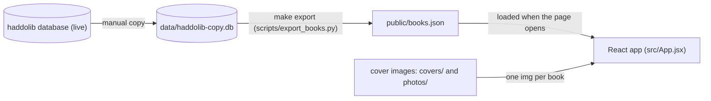
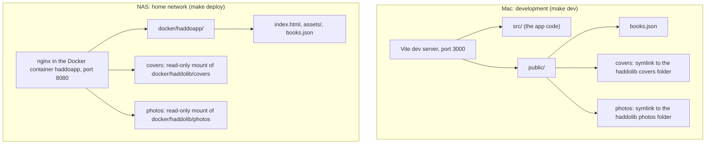
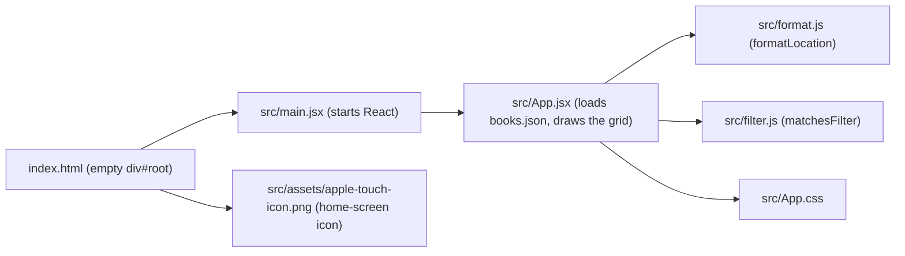

# haddoapp

A read-only browser for our home library, on the iPhone, in the home network only.

haddoapp shows the books catalogued in `haddolib` as a grid of covers in shelf order, with location and tags below each cover. It reads an export of a copy of the `haddolib` database and never changes anything.

---

## Contents

- [Vision and Core Philosophy](#vision-and-core-philosophy)
- [The app](#the-app)
- [Architecture](#architecture)
- [Relation to sibling projects](#relation-to-sibling-projects)
- [Testing strategy](#testing-strategy)
- [Data files](#data-files)
- [Running](#running)

---

## Vision and Core Philosophy

- Browse the library on the phone the way you walk along the shelves: covers side by side, in shelf order.
- Read-only. Cataloguing (bulk import, scanning, tagging) happens in `haddolib`, with its Excel frontend. haddoapp only shows the result.
- An update is small: copy the database, export, copy one file.
- Home network only: no accounts, nothing exposed to the internet.
- This repo is public. It holds code, structure and invented examples, never data about the real library (see [Data files](#data-files)).

---

## The app

- One grid with all books, in shelf order: room, rack, box, position. On the iPhone three covers per row, more on wider screens.
- Below each cover:
  - the title, cut after two lines
  - the ISBN in grey, if the database has one
  - the location as `rack / box (position)`, e.g. `01 / 03 (7)`; a missing part shows as `-`
  - the tags in bold, if any
- Above the grid, a filter field: every typed word must appear in the title, the authors or a tag, also inside a longer word ("physik" finds "Astrophysik"); upper and lower case are ignored. The heading shows how many books match. The field scrolls away with the heading.
- Covers are loaded lazily: the browser only fetches those near the visible part of the page.
- The position is a hint, not a fact: books get put back into their box in a different order.

---

## Architecture

### Data flow



### One app, two places

The app finds `books.json`, `covers/` and `photos/` in the folder it is served from: all its paths are relative. Each machine arranges that these three are there.



On the Mac, `vite.config.js` sets `host: true`, so a phone on the same Wi-Fi can open the development server through the network address that `make dev` prints.

### Inside the app



### `books.json`

A list with one object per book, in shelf order (`room`, `space_label`, `bin_label`, `position`, then `book_id`). Written by `scripts/export_books.py` from the view `book_current` and the tables `book_tag` and `tag`.

| Field         | Type            | Content                                                     |
| ------------- | --------------- | ----------------------------------------------------------- |
| `book_id`     | number          | identity of the book in `haddolib`                          |
| `isbn13`      | string or null  | ISBN-13, if known                                           |
| `title`       | string or null  | from the newest revision; null if the book has none         |
| `authors`     | string or null  | comma-separated, from the newest revision                   |
| `room`        | string or null  | e.g. `Magazin`                                              |
| `space_label` | string or null  | e.g. `rack 01`                                              |
| `bin_label`   | string or null  | e.g. `box 01`                                               |
| `position`    | number or null  | order within the box                                        |
| `tags`        | list of strings | sorted by name, ignoring upper/lower case; empty if no tags |
| `cover_file`  | string or null  | path of the cover image, relative to the app (see below)    |

`cover_file` is made from `cover_ref` of the preferred cover:

- a URL (from ISBNdb) -> `covers/` + the last part of the URL
- anything else (an own photo) -> `photos/` + `cover_ref`, spaces unchanged; the app encodes them
- no cover -> `null`

An invented example:

```json
{
  "book_id": 1,
  "isbn13": "9780000000002",
  "title": "Über Bücher",
  "authors": "Erika Mustermann",
  "room": "Magazin",
  "space_label": "rack 02",
  "bin_label": "box 01",
  "position": 2.0,
  "tags": ["Mathematik", "Physik"],
  "cover_file": "covers/1234567890.jpg"
}
```

---

## Relation to sibling projects

- **`haddolib`** (private): catalogues the books in a SQLite database, with an Excel frontend (PyXLL). It owns the database and the cover images. haddoapp reads a copy of the database, never the live one, and never writes.
- The database structure is in `docs/schema.sql` (generated from the copy with `make schema`; it wins if the two schema files differ) and in `docs/haddolib_prototype.sql` (from `haddolib`, with comments). The read layer is the view `book_current`, one row per book; tags are not in it, because a book has zero to many.

---

## Testing strategy

- `make test` runs both suites.
- Python (pytest, in `tests/`): `make test-py`. The tests build a small invented library from `docs/schema.sql` in a temporary database.
- JavaScript (Vitest): `make test-js`. Test files sit next to the code they test, as `*.test.js`.
- The pre-commit hook (husky) runs Prettier on the staged files and then the JavaScript tests.

---

## Data files

Private, all ignored by git:

- `data/haddolib-copy.db`: the copy of the `haddolib` database that `make export` reads
- `public/books.json`: the export the app loads
- `public/covers`, `public/photos`: symlinks to the image folders of `haddolib` on the Mac

Committed: `docs/schema.sql`, the table structure only.

The repo never holds the catalogue or any export of it. Tests and docs work with invented books.

---

## Running

First-time setup on the Mac:

```
make setup          # npm packages
make setup-python   # .venv with pytest
mkdir -p public
ln -s ~/Projects/haddolib/data/covers public/covers
ln -s ~/Projects/haddolib/data/photos public/photos
```

First-time setup on the NAS, in the shared folder `docker`:

- `haddolib/covers/` and `haddolib/photos/`: copies of the image folders of `haddolib`, made from the Mac with `rsync -rt`, e.g. `rsync -rt ~/Projects/haddolib/data/covers/ /Volumes/docker/haddolib/covers/`. During big copies, no Finder window may be open on the destination folder.
- `haddoapp/`, with two empty folders `covers` and `photos` in it. The container shows the image folders there, and it cannot create these two folders itself, because it may only read `haddoapp/`.
- In Container Manager, a container from the image `nginx`:
  - name `haddoapp`, automatic restart on
  - port 8080 on the NAS -> port 80 in the container
  - three mounts, all read-only ("Schreibgeschützt"):

| NAS folder               | Path in the container          |
| ------------------------ | ------------------------------ |
| `docker/haddoapp`        | `/usr/share/nginx/html`        |
| `docker/haddolib/covers` | `/usr/share/nginx/html/covers` |
| `docker/haddolib/photos` | `/usr/share/nginx/html/photos` |

A container's settings cannot be changed later. To change them, delete the container and create it again; nothing is lost, because the files live in the NAS folders.

Updating the data:

1. With Excel closed, copy the live `haddolib` database to `data/haddolib-copy.db`.
2. `make export` writes `public/books.json`.
3. If the database structure changed: `make schema` refreshes `docs/schema.sql`.
4. With `docker` open in the Finder: `make deploy` builds the app and copies it with `books.json` to the NAS (`NAS_APP=...` for another folder). Then pull the page down in Safari to reload it.

Day to day:

- `make dev`: the app on the Mac at `http://localhost:3000`
- `make test`: all tests once
- `make build`: build the app into `dist/`, without `public/`: no `books.json`, no covers. So `make preview` shows the app without books, only the error message.
- `make deploy`: build, copy to the NAS, check every file
- `make patch`: apply the patches from a session
- `make commit-hash`, `make filesdump`: start of a session with an LLM
- `make help`: all targets
